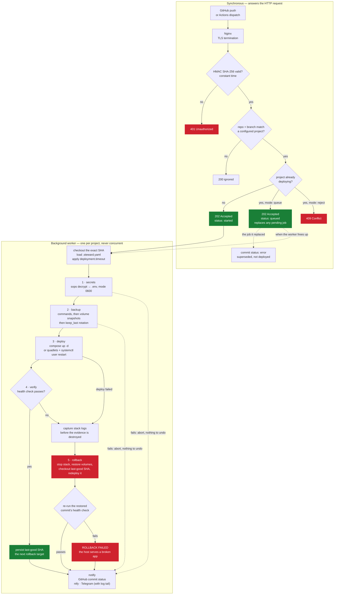

# Steward

A secure, local deployment agent for hybrid homelabs (Proxmox nodes, Mac
Minis, Mac Pros). It sits behind an Nginx reverse proxy, receives GitHub push
webhooks, and orchestrates containerized deployments — Docker Compose or
Podman Quadlets — with SOPS/age secrets, pre-deploy backups, health-checked
rollout, automatic rollback, and GitHub / ntfy / Telegram feedback.

## Documentation

| | |
| --- | --- |
| [docs/architecture.md](docs/architecture.md) | Request path, concurrency model, lifecycle, timeouts, failure matrix |
| [docs/configuration.md](docs/configuration.md) | Every key in `config.yaml` and `.steward.yaml` |
| [docs/host-setup.md](docs/host-setup.md) | Install on Proxmox / macOS: user, SOPS, systemd, launchd, Nginx |
| [docs/github-actions.md](docs/github-actions.md) | CI-gated CD pipelines, image pinning, approvals |
| [docs/operations.md](docs/operations.md) | Runbook, manual rollback, troubleshooting, security model |
| [examples/my-awesome-app/](examples/my-awesome-app/) | A worked application repo |
| [ROADMAP.md](ROADMAP.md) | Planned work, ranked — tests for the destructive paths first — and what we declined |

## Layout

```
cmd/steward/          Entrypoint: flags, `validate` subcommand, lock, shutdown
internal/config/       Agent config + .steward.yaml manifest schema
internal/server/       HTTP server, HMAC-validated webhook, X-Forwarded-For
internal/dispatch/     Per-project queue/reject concurrency, background workers
internal/deploy/       Lifecycle engine: secrets, backup, stacks, health, rollback
internal/git/          Working-checkout sync (clone/fetch/checkout by SHA)
internal/notify/       GitHub Commit Statuses API + ntfy + Telegram
internal/state/        Last known-good commit per project (rollback target)
internal/execx/        Uniform external-command execution
pkg/lockfile/          flock(2)-based single-instance lock
configs/               Example agent config + example .steward.yaml
scripts/               steward-dispatch.sh — sign and POST a deploy from CI
.github/actions/       Composite action wrapping that script
examples/              A worked application repo
docs/                  Architecture, configuration, host setup, CD, operations
```

## Build

```sh
make build       # host binary -> bin/steward
make cross       # linux/amd64 linux/arm64 darwin/amd64 darwin/arm64 -> dist/
make test vet    # tests and static checks
```

Binaries are static (CGO disabled) — copy `dist/steward-linux-arm64`
etc. straight to the target host.

The binary also lints a manifest offline, which is what you want in an
application repo's CI:

```sh
steward validate .steward.yaml
# ✓ .steward.yaml — project "my-awesome-app", stack "quadlet", mode "queue", timeout 10m0s
```

## How a deployment runs



Three properties fall out of that shape.

**The HTTP request never waits on a deployment.** Validation is a signature check
and a project lookup; the `202` is returned before any work begins.

**Rollback is only reachable from steps 3 and 4**, because only those touch the
running system. A failure in secrets or backup aborts with nothing to undo. And a
rollback that redeploys the previous version but never becomes healthy is
reported as `ROLLBACK FAILED` — `compose up -d` returns when a container
*starts*, not when the app works, so the agent checks rather than assumes.

**Queue mode coalesces.** A project's queue holds at most one pending job: a
newer push replaces whatever was waiting, since only the newest commit is worth
deploying. The commit it replaced gets a GitHub status of `error`
("superseded; not deployed") so nothing waits on it forever.

Deploys are keyed to the exact pushed commit SHA; the last commit that passed
its health check is persisted per project and becomes the rollback target.

## Runtime dependencies (deploy hosts)

`git`, `sops` (when secrets are used), `docker`/`docker-compose`/
`podman-compose` (compose stacks), `systemctl --user` + Podman ≥ 4.4 (quadlet
stacks), `rsync` (optional, exact volume restores).

## Configuration

- Agent: [configs/config.example.yaml](configs/config.example.yaml) — listen
  address, webhook secret, GitHub + Telegram tokens, project ↔ repo mapping.
- Per repo: [configs/steward.example.yaml](configs/steward.example.yaml) —
  committed as `.steward.yaml` at the repo root.

### Nginx

```nginx
location /webhook/github {
    proxy_pass http://127.0.0.1:8484;
    proxy_set_header Host $host;
    proxy_set_header X-Real-IP $remote_addr;
    proxy_set_header X-Forwarded-For $proxy_add_x_forwarded_for;
}
```

## Security notes

- Webhook authentication is the HMAC signature, never IP headers;
  `X-Forwarded-For` is parsed for logging/audit only, using the rightmost
  entry — the one appended by the trusted Nginx hop (the leftmost is
  client-forgeable).
- The manifest's secret paths are validated to stay inside the checkout;
  decrypted files are written `0600`.
- Backup rotation only ever deletes directories matching the snapshot naming
  pattern (`<timestamp>-<sha>`), never other content in the destination.
- Manifest commands (backup hooks, command health checks) run as the agent
  user: anyone who can push to a deployed branch can execute commands, same
  trust model as self-hosted CI. Run the agent as a dedicated user.
- One instance per host, enforced with an flock(2) lock file.
- The Telegram bot token lives in the agent config, never in a repo-committed
  manifest, and is scrubbed from error text before it reaches the logs (the Bot
  API carries the token in the request URL).
